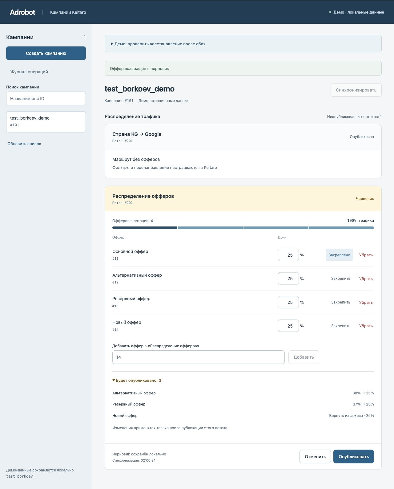

# Adrobot

Создание кампаний Keitaro и управление офферами: сохраняемые черновики, архив, закреплённые доли и восстановление после потерянного ответа API.

**FastAPI · SQLAlchemy · Alembic · SQLite · React · TypeScript**



## Попробовать за минуту

Нужны Docker Engine и Compose v2.

```bash
git clone https://github.com/nolletinfluence/adrobot-keitaro.git
cd adrobot-keitaro
cp .env.example .env
docker compose up
```

Откройте [localhost:5173](http://localhost:5173). API: [localhost:8000/docs](http://localhost:8000/docs).

Пример конфигурации явно включает **демо-режим**: готовую кампанию, два потока и четыре оффера. API-ключ не требуется, обращения к реальному Keitaro не выполняются. Изменения сохраняются после перезапуска. На первом запуске устанавливаются зависимости и применяются миграции.

## Проверить основное ТЗ

1. Откройте готовую кампанию: первый поток — страна KG → Google, второй распределяет трафик между офферами.
2. Добавьте четвёртый оффер: получите 25/25/25/25. Жёлтый заголовок и список изменений показывают черновик. Перезагрузите страницу — он сохранится.
3. Нажмите **Отменить** или **Опубликовать**. Публикация отражается в журнале операций.
4. Уберите оффер, опубликуйте, затем верните его из архива.
5. Закрепите долю 25%. Остальные офферы делят оставшиеся 75%; целочисленное округление сохраняет сумму ровно 100%.
6. Создайте свою кампанию: название, ISO-код страны, оффер, домен, группа и источник. Два потока создаются автоматически.

## Проверить потерю ответа

В демо раскройте **«Проверить восстановление после сбоя»**.

1. Измените реальное распределение: добавьте или уберите оффер либо задайте новую долю.
2. Нажмите **Потерять следующий ответ публикации**, затем **Опубликовать**.
3. Демо применит запись и оборвёт ответ. Интерфейс покажет неподтверждённый результат и защитит поток от дальнейших правок.
4. Нажмите **Проверить результат**. Приложение прочитает Keitaro, подтвердит сохранённое намерение и завершит локальную публикацию **без повторного PUT**.
5. В журнале будет виден итог операции. Обновление страницы и перезапуск backend не теряют её состояние.

Это разовый сценарий локального симулятора. В live-режиме маршрут управления сбоями недоступен.

## Подключить реальный Keitaro

В `.env`:

```dotenv
KEITARO_MODE=live
KEITARO_BASE_URL=https://your-keitaro.example
KEITARO_API_KEY=your-admin-api-key
CAMPAIGN_PREFIX=test_borkoev_
```

Перезапустите backend с обновлённым окружением. Ключ используется только сервером. Кампании с указанным тестовым префиксом доступны для изменения; остальные данные защищены от записи.

Демо и live используют разные файлы SQLite: к имени демо-базы автоматически добавляется `-demo`. Журнал привязан к конкретному трекеру. Для другого live-трекера нужна отдельная база или отдельный проект Compose — старые операции нельзя сверять с новым сервером.

## Что обеспечивает реализация

| Ситуация | Поведение |
| --- | --- |
| Обновление страницы с черновиком | Данные, архив и закрепления остаются в SQLite |
| Повтор создания с тем же `Idempotency-Key` | Возвращается сохранённый результат; новая кампания не создаётся |
| Тот же ключ с другими параметрами | 409 до удалённой записи |
| Keitaro применил PUT, ответ потерялся | Сохранённое намерение сверяется с удалённым состоянием |
| Падение после удалённого успеха | Журнал и снимок публикации позволяют завершить локальную запись |
| Неизвестный исход публикации | Правки, отмена и синхронизация потока блокируются до проверки |
| Внешняя правка в Keitaro | Конфликт сохраняет локальный черновик |
| Удаление оффера извне | После синхронизации привязка остаётся в локальном архиве |
| Медленный удалённый запрос | Сетевой вызов выполняется вне транзакции SQLite; локальные чтения продолжаются |
| Ошибка | Структурированный код, исход операции и `X-Request-ID`; секреты не попадают в ответ |

## Структура

```text
backend/
  app/                API, orchestration, журнал, Keitaro adapter и чистый расчёт долей
  migrations/         версионированная схема Alembic
  tests/              сценарии API/DB, потери ответов, рестарта и конкуренции
frontend/
  src/                редактор, preview изменений, восстановление и журнал
  src/testing/        фикстуры интерфейсных тестов
docs/                 контракт, архитектура, приёмка и результаты проверки
compose.yml           локальный запуск backend и frontend
```

## Запуск без Docker

Нужны Python 3.12+, SQLite 3.35+ и Node.js 24.15+. Версия SQLite важна для безопасного отката `0002` без пересоздания таблицы потоков.

```bash
python3 -m venv .venv
.venv/bin/python -m pip install -r backend/requirements-dev.txt
cp .env.example .env
```

Для локального запуска замените в `.env` контейнерный путь базы:

```dotenv
DATABASE_URL=sqlite:///./data/adrobot.db
```

Первый терминал:

```bash
cd backend
set -a
. ../.env
set +a
../.venv/bin/alembic upgrade head
../.venv/bin/uvicorn app.main:app --host 127.0.0.1 --port 8000 --workers 1
```

Второй терминал:

```bash
cd frontend
npm ci
npm run dev -- --host 127.0.0.1
```

Vite проксирует `/api` на backend. Для другого адреса используйте `API_PROXY_TARGET`. В демо провайдер хранит свои данные рядом с SQLite в `keitaro-demo.json`.

## Миграции

При запуске Compose выполняется `alembic upgrade head`. Схема не создаётся автоматически через `create_all`.

```bash
docker compose exec backend /opt/venv/bin/alembic current
docker compose exec backend /opt/venv/bin/alembic upgrade head
```

Без Docker — из `backend/` с загруженным `.env`:

```bash
../.venv/bin/alembic current
../.venv/bin/alembic upgrade head
```

`0001` содержит кампании, офферы и черновики; `0002` добавляет журнал, резервирование публикаций и привязку к трекеру. Проверка миграции включает сохранность существующего черновика. Откат удаляет соответствующие новые данные; используйте его на одноразовой базе или после резервной копии.

## Тесты и проверка

```bash
cd backend
../.venv/bin/python -m pytest -q
../.venv/bin/python -m ruff check .
../.venv/bin/python -m ruff format --check .
```

```bash
cd frontend
npm test
npm run build
```

Тесты отказов воспроизводят запись **до** потери ответа, локальный сбой после удалённого PUT, перезапуск с той же БД, идемпотентный повтор и конфликт внешней правки. Отдельные тесты проверяют инварианты распределения и безопасность действий интерфейса при неизвестном результате.

[Фактические результаты](docs/VERIFICATION.md) · [Сценарий приёмки](docs/ACCEPTANCE.md) · [Архитектура](docs/ARCHITECTURE.md) · [Контракт API](docs/API.md) · [Использование AI](docs/SUBMISSION.md)

## Границы решения

Поддерживается **один backend worker**. SQLite-транзакции короткие; блокировки текущего процесса координируют операции. Несколько процессов потребуют отдельного механизма координации.

Keitaro не предоставляет conditional PUT/ETag: между проверкой и записью внешний клиент всё ещё может изменить поток. Проверка после таймаута не всегда доказывает отказ — неполное создание или неподтверждённый результат остаются явно неопределёнными для ручной проверки. Exactly-once на стороне внешнего API не обещается.

Compose — локальное окружение: зависимости устанавливаются при старте, порты привязаны к `127.0.0.1`. Публичное размещение потребует авторизации, управления доступом и отдельной подготовки контейнерных образов.

```bash
docker compose down
```

Данные сохраняются в volumes. `docker compose down -v` намеренно удаляет локальные базы и демо-данные.
