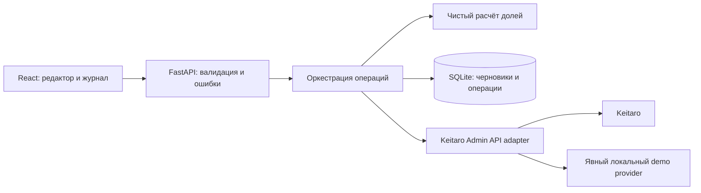
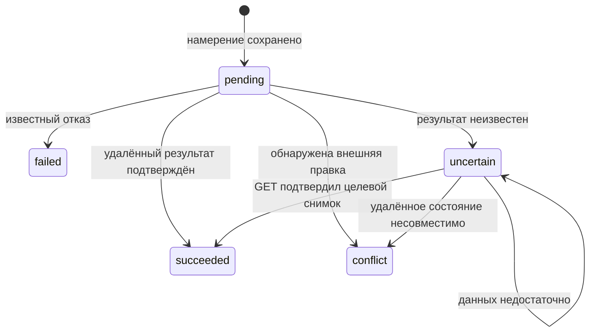
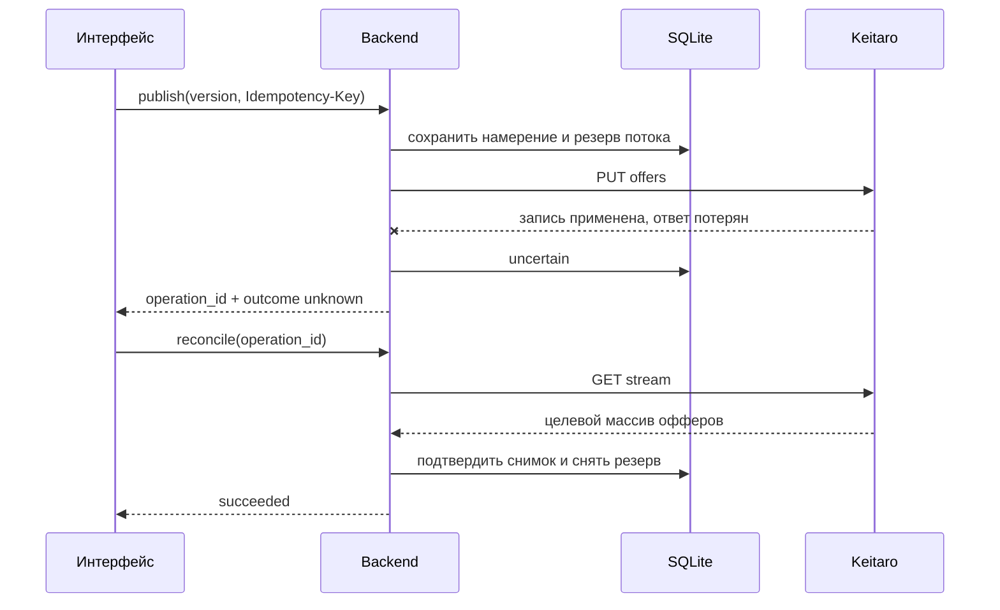

# Архитектура и гарантии

## Границы компонентов

Frontend отправляет намерения пользователя. Backend рассчитывает доли, защищает версии и хранит опубликованный снимок отдельно от черновика. HTTP-клиент знает протокол Keitaro; расчёт распределения не зависит от FastAPI, SQLAlchemy или сетевых вызовов.

## Транзакции и конкуренция

Короткая транзакция читает или фиксирует локальное состояние и завершается до обращения к Keitaro. Общая блокировка SQLite охватывает только эту транзакцию. Блокировка кампании координирует её изменяющие операции в поддерживаемом одном процессе. Обычное чтение другой кампании не ждёт медленный upstream.

Публикация сохраняет неизменяемое намерение и резервирует поток до удалённой записи. Пока результат неизвестен, нельзя редактировать, отменять или синхронизировать его поверх этого намерения. При подтверждении сохраняется именно отправленный снимок, включая закрепления.

## Журнал операций

Операция содержит вид, ключ идемпотентности, хеш входных параметров, фазу, статус, известные удалённые ID, контекст восстановления, результат и timestamps. Намерение фиксируется **до** первого POST/PUT.

Одинаковый ключ и входные параметры возвращают сохранённый результат без новой записи в Keitaro. Другие параметры с тем же ключом дают 409. Незавершённая попытка требует проверки; приложение не создаёт для неё новый alias и не повторяет неоднозначный POST.

Для создания сохраняется стабильный alias. Проверка ищет именно эту кампанию и сверяет два ожидаемых потока. Неполная кампания остаётся неопределённой с известным ID для ручной проверки. Для публикации сохраняются baseline, целевой массив офферов и локальный pin-снимок.

## Потерянный ответ публикации

Reconcile делает только удалённые GET. Совпадение с целью завершает локальную запись без нового PUT. Совпадение с прежним baseline само по себе не доказывает, что исходный запрос никогда не выполнится, поэтому не превращается в автоматический повтор.

Порядок элементов удалённого массива не считается изменением распределения: сравниваются пары offer_id/share/state. Локальная позиция оффера отдельно определяет стабильное округление.

## Доли и архив

`Allocation` — неизменяемое значение; `allocate_weights` возвращает новый набор целых долей. Закреплённые активные доли сохраняются. Остаток делится поровну, неделимые проценты распределяются по стабильной позиции и ID. Сумма равна 100; архив получает 0.

Примеры: три свободных оффера 34/33/33; закреплённый 25 и два свободных 25/38/37; после добавления третьего свободного 25/25/25/25. Невозможные суммы и удаление последнего активного оффера отклоняются до записи.

Привязка оффера имеет собственное архивное состояние. Отмена удаляет привязки, существовавшие только в черновике; каталог офферов остаётся. Внешнее удаление становится архивом после синхронизации.

## Изоляция и наблюдаемость

Демо использует отдельную SQLite с суффиксом `-demo` и локальный атомарно сохраняемый provider state. Оно не использует live-ключ. Журнал и база привязаны к провайдеру; смена live URL не позволяет применить старые ID к новому трекеру.

Ошибки сохраняют совместимый `detail` и добавляют `code`, `operation_id`, `outcome`, `request_id`. Ответ содержит `X-Request-ID`; журнал и структурированные логи помогают связать запрос с операцией. Заголовки авторизации, ключи и сырые ответы провайдера не логируются.

## Честные ограничения

- Координация записей рассчитана на один worker. Для нескольких процессов нужен механизм владения операцией на уровне общей БД.
- В Keitaro нет conditional PUT: внешняя запись между preflight GET и PUT остаётся возможной.
- HTTPX ограничивает сетевые фазы; общий бюджет проверяется перед каждым вызовом. Это не строгий wall-clock дедлайн удалённой обработки.
- В частично созданной кампании приложение не повторяет неоднозначный POST потока. Нужна ручная проверка в Keitaro.
- Авторизация для публичного размещения и production-инфраструктура находятся за границами локального тестового задания.
